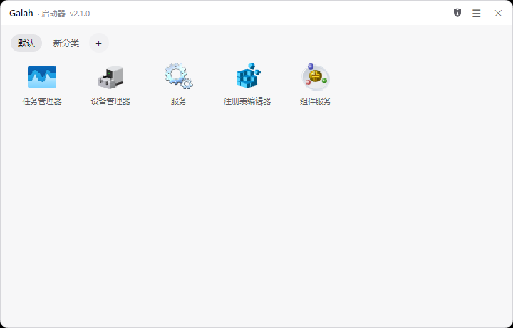
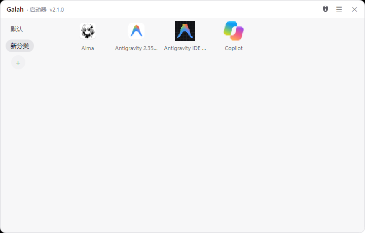
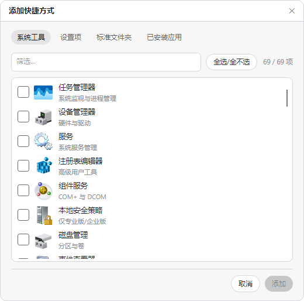
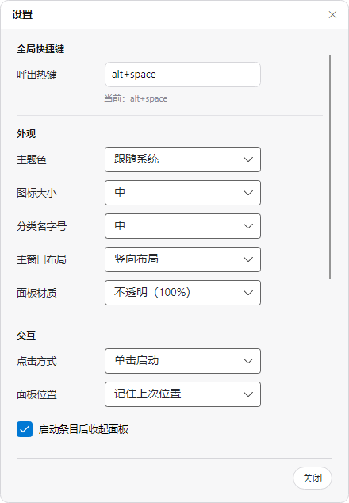
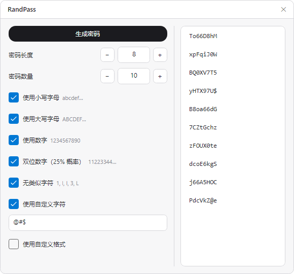

# Galah 2.0

Windows 桌面启动器（launcher），以作者家的宠物凤头鹦鹉命名。绿色免安装，数据就在 exe 旁边。

用 **Avalonia 11 + NativeAOT** 重写；1.x 是 WPF 版本，在另一个仓库 [simondai/galah](https://github.com/simondai/galah)。

  

## 它是什么

把常用的程序、文件、文件夹、网址、系统设置页收进一个面板：分类页签 + 图标磁贴网格，
单击/双击启动，托盘常驻后台，全局热键（Alt+Space）随时唤出。
所有数据（分类、条目、设置、窗口状态）都落在 exe 同目录的 `GalahData/` 文件夹，随文件夹一起搬走。

- **绿色免安装**：4 个文件共约 43.6 MB（本次实测 45,701,776 B），原生编译，不装 .NET 运行时、不写注册表、不留后台服务
- **默认不联网**：没有任何自动网络行为；唯一的联网操作是你在编辑网址条目时手动点"获取网站图标"，且只访问该站点本身
- **持久可靠**：写盘原子替换 + 双备份轮换（`.bak.1`/`.bak.2`），字段级 `null` 归一、设置全字段校正、损坏自动隔离，一次用户动作一次写盘
- **内置 RandPass**：面板标题栏、☰ 菜单、托盘菜单三个入口打开同一生成器，参数持久化，双击结果即复制

> **先读 [FINDINGS-2.0.md](FINDINGS-2.0.md)，别默认这次重写省内存。**
> 实测下来内存并不是立项时想的那样：**待机反而比 1.x 更费**，面板只省 5~13%。
> 2.0 真正兑现的是 **体积小约 36%**（68.6 MB → 43.6 MB）、**不依赖 .NET 运行时**、
> 以及原生启动速度。

## 界面预览

| 主面板（横向布局） | 主面板（竖向布局） |
|---|---|
|  |  |

| 添加快捷方式 | 设置 | RandPass 密码生成 |
|---|---|---|
|  |  |  |

---

## 快速开始

拿到产物后，直接双击 `artifact/Galah2.exe` 即可。启动后驻留托盘（不弹面板），
按 **Alt+Space** 或点托盘图标唤出。

## 产物与发布

自己构建的话，产物在仓库根目录的 **`artifact/`**（4 个文件，约 43.6 MB）：

```powershell
powershell -ExecutionPolicy Bypass -File tools/publish-aot.ps1
```

`artifact/GalahData/` 是程序运行时生成的用户数据，不进发布包；`tools/release.ps1 -Version <版本>`
会把 4 个文件打成 `dist/Galah2-v<版本>-win-x64.zip`，CI 在打 tag 时另出
`Galah2-windows-x64.zip`。绿色版怎么用、为什么不是单文件、CI 曾经怎么把包做坏，
以及两条发布路径的差异，都写在 **[PORTABLE.md](PORTABLE.md)**。

## 功能状态

| 功能 | 状态 |
|---|---|
| 托盘图标、左键唤出、右键原生菜单 | 可用 |
| 全局热键（消息窗常驻，面板从未显示也能唤出） | 可用 |
| 单实例 + 转发 toggle | 可用 |
| 面板：自定义标题栏、☰ 菜单、条目网格、右键菜单、拖动 | 可用 |
| 分类条顶部/左侧切换，图标三档尺寸、分类名字号四档 | 可用 |
| 直接读 1.x 的 `GalahData/catalog.json` | 可用 |
| 条目启动（exe / lnk / url / protocol；`.msi`/`.bat`/`.cmd`/`.com` 走 Shell） | 可用 |
| 桌面快捷方式读写，**不用 `ComImport`** | 可用，11 调用点 |
| 图标提取 + PNG 缓存（含 .msc） | 可用，8 调用点 / 12 条 PASS |
| 设置（主题、图标尺寸、布局、材质、点击方式、面板位置、热键、自启、快捷方式、分类名字号、添加占位磁贴、滚轮/数字键开关） | 可用，27 调用点 / 28 条 PASS |
| 开机自启（写 HKCU Run，启动时再断言） | 可用 |
| 添加选择器（4 个来源、搜索、多选、列表带图标） | 可用 |
| 编辑对话框（带提交校验门） | 可用 |
| 库维护：扫描、清失效、去重、排序、重建图标缓存 | 可用 |
| 整库导出与导入 | 可用 |
| 提示框与确认框 | 可用 |
| 对话框无边框自绘标题栏、Esc/Enter、不进任务栏 | 可用，60 调用点（DialogProbe） |
| 拖放文件、粘贴 URL | 可用 |
| 启动失败的 toast 提示 | 可用 |
| URL 条目抓取站点图标（仅手动按钮触发，支持 http→https 跳转与超时提示） | 可用 |
| 浏览按钮：选文件、选目录、选图标图片 | 可用 |
| 面板命令面 | 可用，126 调用点 |
| 进程级验收（托盘、toggle、关闭后重开） | 可用，11 调用点 |
| 绿色版自检 | 可用，9 调用点 |
| 回滚兼容性（1.x ↔ 2.0 数据） | 可用，9/9（`tools/rollback-check.ps1`） |
| 面板可缩放、位置与尺寸记忆（高 DPI 单位统一） | 可用，14 调用点 |
| 面板材质：不透明 / 半透明 | 可用，5 调用点 / 4 条 PASS |
| 分类圆片右键菜单（重命名 / 删除，空分类守卫） | 可用 |
| 「＋ 添加」占位磁贴（默认关闭，设置可开） | 可用 |
| 拖拽排序：分类换位、磁贴换位、跨分类移动 | 可用，DragArmProbe 10 + InteractionProbe 19 调用点 |
| 键盘导航：Ctrl+1..9 / 小键盘 / 方向键，列表边缘滚轮切分类 | 可用 |
| Ctrl+Tab / Ctrl+Shift+Tab 回绕切换分类 | 可用 |
| RandPass 密码生成器（三入口、参数持久化、双击复制） | 可用，22 调用点 |
| 数据健壮性：字段级 `null` 归一、设置全字段校正、导入整份替换、导出中文不转义 | 可用（2026-11-25 审计整改） |
| 主题「跟随系统」实时跟随、退出幂等释放 | 可用 |
| 协议白名单（`search-ms:` / `ms-about:`） | 可用 |
| **最大化状态记忆** | **不适用**（无边框面板不提供最大化） |
| NativeAOT 发布 | 可用，见 [PORTABLE.md](PORTABLE.md) |

---

## 构建

```bash
dotnet build Galah2.sln -c Release
```

运行：

```bash
dotnet run --project src/Galah2 -c Release
```

exe 会在自己旁边找 `GalahData/`（和 1.x 同一套约定），把已有的内容库拷进去就能用真实数据测。

### NativeAOT

需要 **VS 2022 或 Build Tools 的「使用 C++ 的桌面开发」工作负载**加 Windows SDK——
ILCompiler 用 MSVC 的 `link.exe` 链接。

```bash
dotnet publish src/Galah2 -c Release -r win-x64 -p:PublishAot=true -o artifact
```

**AOT 必须真实启动验证，不能只看编译通过。** `JsonSerializer` 的反射序列化在 AOT 下会抛
`JsonSerializerIsReflectionDisabled`，而且是在**任何窗口创建之前**——表现出来就是
"双击没反应"。发布成功不代表能跑。必须启动一次，确认托盘图标出来了。

---

## 验收

`tools/` 下共 **12 个探针**，全部已收录在 `Galah2.sln` 中，均可独立运行。

```bash
dotnet run --project tools/ComProbe         -c Release   # COM 往返（11）
dotnet run --project tools/IconProbe        -c Release   # 图标提取（8 调用点 / 12 条 PASS）
dotnet run --project tools/SettingsProbe    -c Release   # 设置与主题（27 调用点 / 28 条 PASS）
dotnet run --project tools/PanelProbe       -c Release   # 面板命令面（126）
dotnet run --project tools/UiAcceptance     -c Release -- src/Galah2/bin/x64/Release/net8.0/Galah2.exe  # 进程级（11）
dotnet run --project tools/PortableCheck    -c Release -- artifact     # 绿色版（9）
dotnet run --project tools/DialogProbe      -c Release   # 对话框（60）
dotnet run --project tools/GeometryProbe    -c Release   # 几何（14）
dotnet run --project tools/MaterialProbe    -c Release   # 材质（5 调用点 / 4 条 PASS）
dotnet run --project tools/InteractionProbe -c Release   # 输入路由（19）
dotnet run --project tools/DragArmProbe     -c Release   # 拖拽状态机（10）
dotnet run --project tools/PasswordProbe    -c Release   # 密码生成（22）
```

`UiAcceptance` 与 `PortableCheck` 的参数都可省略：前者自动在 `bin/Release` 或
`bin/x64/Release` 下找 `Galah2.exe`，后者默认找仓库根目录的 `artifact/`。

括号内是源码里 `Check(` **调用点**数（合计 **322**）。循环展开与条件分支会让实际
PASS 行数与调用点数不同：命令表标出了 Icon / Material / Settings 三处。CI（`build2.yml`）跑全部 12 个；
`--no-build` 优化与 sln 补录属于 `FIX-REPORT-2026-11-25.md` 的阶段 B 遗留项。

内存测量：

```powershell
powershell -ExecutionPolicy Bypass -File tools/perf/measure.ps1
```

报告 **Private Working Set**（任务管理器"内存"列那个数）。Working Set 含共享 DLL 页，
会虚高近一倍，不要拿它当应用自己的内存。

---

## 目录结构

```
Galah2.sln                         主项目 + 12 个探针项目
.github/workflows/build2.yml      CI：构建、12 个探针、AOT 发布、绿色版校验
src/Galah2/
  App.axaml / App.axaml.cs        应用入口与资源
  Program.cs / app.manifest
  Galah2.csproj / aot.props       项目与 NativeAOT 配置
  Assets/galah.ico
  Models/                         Catalog / SettingsDocument / UiStateDocument / PasswordOptions
  Persistence/                    AppDataPaths / JsonContext / JsonFileStore /
                                  CatalogStore / SettingsStore / UiStateStore
  Services/
    AppRuntime.cs                 启动、托盘、热键、单实例、几何记忆
    CatalogSources/               添加选择器的 4 个来源 + 聚合服务 + 种子数据
    Interop/                      ShellLinkCom / ShellIconHandler / Win32
    ...                           Launcher / Icon / Theme / Tray / Hotkey / AutoStart /
                                  Migration / Import / Maintenance / Favicon /
                                  PasswordGenerator / ProtocolSafety / TabNavigation /
                                  Toast / DiagnosticsLog / ItemValidator / PanelPlacement
  ViewModels/                     Panel / Settings / EditItem / AddPicker / Maintenance /
                                  RandPass / Mvvm
  Views/                          PanelWindow + 7 个对话框/工具窗口 +
                                  DialogChrome / DragArmState
  Styles/Tokens.axaml             全部颜色 token（深浅两套）
  Styles/Baseline.axaml           全部控件样式
  Properties/AssemblyInfo.cs
tools/                            12 个独立探针
  ComProbe/          COM 往返              IconProbe/        图标提取
  SettingsProbe/     设置与主题            PanelProbe/       面板命令面
  UiAcceptance/      进程级验收            PortableCheck/    绿色版验证
  DialogProbe/       对话框                GeometryProbe/    几何与选择器图标
  MaterialProbe/     面板材质              InteractionProbe/ 输入路由
  DragArmProbe/      拖拽状态机            PasswordProbe/    密码生成
  perf/measure.ps1               Private Working Set 内存测量
  publish-aot.ps1                AOT 发布到 artifact/（自动删 .pdb）
  release.ps1                    本地打 zip 到 dist/ 并上传 Release
  rollback-check.ps1             1.x <-> 2.0 数据兼容
docs/
  specs/                         需求规格（每轮开发前写）
  PROCESS-AUDIT.md               流程自查
  PLAN-2026-11-25-REMEDIATION.md 审计整改计划
evidence/                        实测截图（如 panel-aot.png）
artifact/                        本地 AOT 产物：4 个文件 + 运行后生成的 GalahData/
dist/                            release.ps1 生成的 zip 与 stage/（按需生成，.gitignore 忽略）
根目录文档                       README / CHANGELOG / CONTRIBUTING / PORTABLE /
                                 FINDINGS-2.0 / PLAN-2.0 / AUDIT-2026-11-25-FULL /
                                 FIX-REPORT-2026-11-25 / REVIEW-2026-11-25 / LICENSE
```

## 系统要求

- Windows 10 1709+ / Windows 11（x64）
- 运行时自包含，无需安装 .NET

## 二次开发

### 开发环境

- [Visual Studio 2022](https://visualstudio.microsoft.com/)（或任意顺手的 C# IDE / VS Code）
- **.NET SDK 8.0+**
- **VS 2022 Build Tools 的「使用 C++ 的桌面开发」工作负载 + Windows SDK** ——
  NativeAOT 用 MSVC 的 `link.exe` 链接，缺了只能编译不能发布
- Git

克隆后两条命令验证环境：

    dotnet build Galah2.sln -c Release
    dotnet run --project tools/PanelProbe -c Release

只想跑起来不改 AOT，`dotnet run --project src/Galah2 -c Release` 就行（JIT 模式，启动慢些）。

### 本项目的开发工具链

- **Alma**（AI 结对编程）：需求拆解、实现、测试与调试的主力
- **Git + GitHub Actions**：版本管理；CI 自动跑构建、12 个探针、AOT 发布与绿色版校验
- **dotnet CLI**：构建、测试、AOT 发布，不依赖 IDE
- **PowerShell + Win32/UIA**：进程级验收脚本与诊断

### 代码地图

| 你要改的东西 | 去哪 |
|---|---|
| 面板外观与交互路由 | `src/Galah2/Views/PanelWindow.axaml` + `.axaml.cs` |
| 颜色、深浅主题 | `src/Galah2/Styles/Tokens.axaml`（两套配色）+ `Baseline.axaml`（控件样式） |
| 面板命令、分类与条目逻辑 | `src/Galah2/ViewModels/PanelViewModel.cs` |
| 设置窗口与设置归一化 | `src/Galah2/Views/SettingsWindow.axaml(.cs)` + `ViewModels/SettingsViewModel.cs` + `Persistence/SettingsStore.cs` |
| 启动流程、托盘、热键、单实例、几何记忆 | `src/Galah2/Services/AppRuntime.cs` |
| 图标提取（含 .msc 的 COM 路径） | `src/Galah2/Services/IconService.cs` + `Services/Interop/ShellIconHandler.cs` |
| JSON 存储、源生成器、字段级 `null` 归一 | `src/Galah2/Persistence/` |
| 手写 COM vtable（AOT 必需） | `src/Galah2/Services/Interop/` |
| 添加选择器（4 个来源） | `src/Galah2/Services/CatalogSources/` + `Views/AddPickerWindow.axaml(.cs)` |
| 拖拽排序与跨分类拖动 | `src/Galah2/Views/DragArmState.cs` + `Views/PanelWindow.axaml.cs` |
| 键盘 / 滚轮分类导航 | `src/Galah2/Services/TabNavigation.cs` + `Views/PanelWindow.axaml.cs` |
| RandPass 密码生成器 | `src/Galah2/Services/PasswordGenerator.cs` + `Views/RandPassWindow.axaml(.cs)` + `ViewModels/RandPassViewModel.cs` |
| 整库导出 / 导入、备份兼容 | `src/Galah2/Services/MigrationService.cs` + `Services/ImportService.cs` |
| 站点图标抓取、协议白名单 | `src/Galah2/Services/FaviconService.cs` + `Services/ProtocolSafety.cs` + `Services/UrlSafety.cs` |

改完按 [CONTRIBUTING.md](CONTRIBUTING.md) 的九步流程走：先写 `docs/specs/`，再动代码，
跑全套探针，最后提交。

## 名字与致敬

Galah（凤头鹦鹉）是作者家的宠物。粉红凤头鹦鹉聪明、话多、精力旺盛——大概也是一个好启动器的样子。

本项目致敬 [Rolan](https://getrolan.com/) 的作者。作者本人是 Rolan 2 近十年的老用户；Galah 的
功能原型参考自 Rolan，但全部代码从零实现，不含任何 Rolan 的代码、图标或素材。

## 许可证

GNU General Public License v3.0 — 见 [LICENSE](LICENSE)（GNU 官方全文）。

Copyright (C) 2026 simondai

- 可以自由使用、修改和分发
- 衍生作品必须以 GPL v3.0 相同许可证开源
- 必须保留原始版权声明
